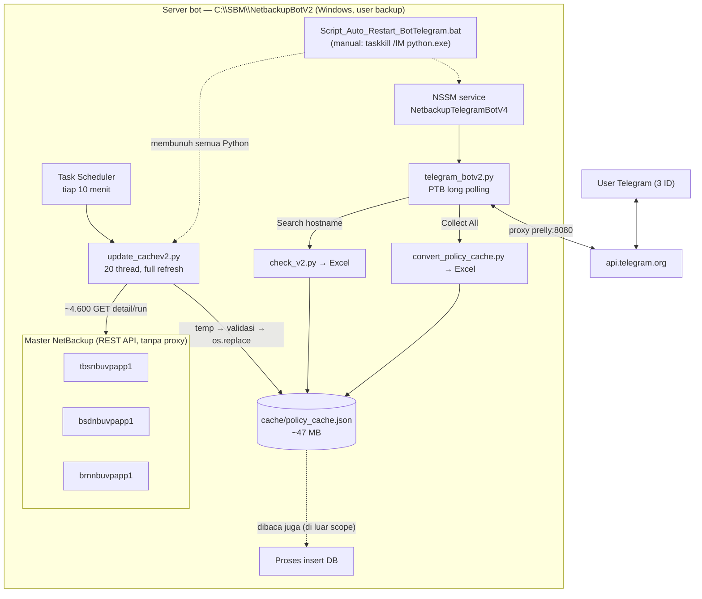
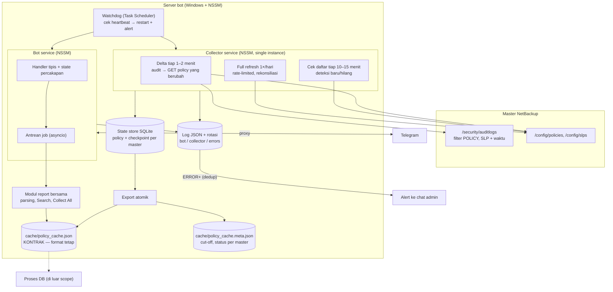

# Fase 1 — Assessment Report: NetBackup Telegram Bot (v2)

| | |
|---|---|
| Versi | 0.1 (draft untuk review) |
| Tanggal | 2026-11-24 |
| Baseline | `SYSTEM_DESIGN_PRODUCTION_GUIDE_CLAUDE.md` §18 Phase 1 |
| Sumber bukti | Salinan `C:\SBM\NetbackupBotV2` per 2026-11-20 (di `D:\bot\NetbackupBotV2`): kode, `bot_service.log`, `logs\*.txt`, `log_restart.txt`; audit log master BRN (ditarik 2026-11-20) |
| Kode diubah? | Tidak. Fase 1 hanya analisis. |

Notasi: **[V]** terverifikasi dari bukti · **[A]** asumsi, perlu konfirmasi · **[M]** informasi belum tersedia.

---

## 1. Executive summary

Bot nyangkut bukan karena satu bug, tetapi karena desain yang tidak tahan gangguan:

1. **Koneksi ke Telegram rapuh.** Lewat proxy yang kadang gagal, dengan pool koneksi kecil dan tanpa pemulihan otomatis. Bot diam (`PoolTimeout`) atau keluar saat start (`Bootstrap ... Aborting`). [V]
2. **Collector berjalan ganda.** Pada 82% jadwal (654 dari 800 slot dalam 7 hari), dua collector berjalan bersamaan dan berebut file temp yang sama. Ribuan update gagal (JSON rusak) dan beban ke NBU dua kali lipat. [V]
3. **Tidak ada deteksi masalah.** Tidak ada heartbeat bot, watchdog, alert, atau ID error. Masalah diketahui dari komplain user, lalu restart manual dengan `taskkill /IM python.exe` yang ikut membunuh collector. [V]
4. **Ada bug data.** Report "Collect All" menampilkan nama hari backup bergeser satu hari, karena mapping hari berbeda dengan Search. Mapping yang benar sudah dibuktikan dari audit log. [V]
5. **Secret tersebar.** Token bot dan 3 API key NBU ada di kode, dan token bot tercatat di log setiap 10 detik. [V]

Kabar baiknya, **audit log NetBackup terbukti mencatat setiap perubahan policy** dan bisa difilter di sisi server. Collector bisa diubah dari "ambil ulang ±4.600 policy setiap 10 menit" menjadi "ambil yang berubah saja" (±5 perubahan per hari di BRN), dengan full refresh sekali sehari sebagai jaring pengaman. [V]

Rekomendasi: **modular monolith di server yang sama** (Windows + NSSM), tanpa menambah Docker, Redis, atau Kubernetes. Mulai dengan quick wins Fase 0 (CR), lalu bangun v3 bertahap dengan v2 sebagai jalur rollback.

---

## 2. Arsitektur saat ini

---

## 3. Temuan per area (guide §19 A–N)

### A. Struktur repository
- Satu folder datar berisi 4 file bot, ±10 skrip lain (di luar scope), folder data runtime (`cache`, `hasil`, `logs`, `report_csv`), file LOCK, ZIP lama, dan folder `backup final script maret 2026` sebagai "versi". [V]
- Tidak ada Git, `requirements.txt`, README, atau test. [V]

### B. Stack dan dependency
- Python 3.13 (`C:\Users\backup\AppData\Local\Programs\Python\Python313`). [V dari traceback]
- python-telegram-bot (PTB) dengan httpx, pandas, openpyxl, requests, urllib3. [V]
- Versi PTB dan httpx belum diketahui. [M] Ini menentukan opsi tuning koneksi.
- NSSM (service `NetbackupTelegramBotV4`) dan Task Scheduler. [V] Konfigurasi detail keduanya belum diketahui. [M]
- Internet keluar lewat `HTTP(S)_PROXY=prelly.telkomsel.co.id:8080`, di-set di dalam kode. [V]
- NBU REST API, header `version=11.0` (BRN juga mendukung 12.0). [V]

### C. Arsitektur dan alur request
- **Search:** `/start` → tombol → user kirim daftar hostname → `asyncio.to_thread(run_check)` → memuat JSON 47 MB → filter → Excel → `send_document`. [V]
- **Collect All:** tombol → `to_thread(convert_policy_cache_to_report)` → memuat JSON 47 MB → Excel semua policy → kirim. Tanpa kunci, jadi bisa berjalan paralel. [V]
- **Collector:** daftar policy (paging 50) → GET detail per policy (20 thread) → GET SLP (10 thread) → validasi → replace atomik. Ketiga master diproses berurutan; satu master gagal membuat seluruh run gagal. [V]

### D. Fitur dan business logic (harus dipertahankan)
- Akses: whitelist 3 Telegram user ID, keduanya mendapat 2 menu. Sesi 10 menit. [V]
- Filter: hanya policy `active`; lewati nama yang mengandung `onetime` atau `manual`; jadwal tanpa start window dilewati. [V]
- **Pencocokan hostname memakai substring** (`any(t in host ...)`). Contoh: `app1` juga cocok dengan `app10`. [V] Apakah ini memang diinginkan? [A]
- Retensi: SLP memakai `operationList[1]` (operasi kedua); non-SLP memakai `backupCopies.copies[0]`. [V] Alasan bisnisnya belum diketahui. [A]
- Hostname yang tidak ditemukan ditulis sebagai baris "Not Available" (merah) di report Search. [V]
- Report diberi baris cut-off di A1, dengan jam diambil dari baris terakhir `logs/update_log.txt`. [V]

### E. Data store
- `policy_cache.json` ±47 MB: 4.606 policy dan 186 SLP (run 2026-11-20 10:52). [V]
- Validasi: minimal 1.000 policy, minimal 40 MB, JSON bisa di-load ulang. Batas ukuran tetap ini rapuh. [V]
- Penulisan atomik (`os.replace`) sudah benar, tetapi file temp dipakai bersama oleh run yang berjalan ganda. [V]
- File yang sama dibaca proses DB di luar scope, jadi **ini kontrak data**. [V]

### F. Authentication dan authorization
- Whitelist user ID tertulis di kode; tidak ada role selain akses menu. [V]
- Tidak ada audit siapa mencari hostname apa. [V]
- Role atau privilege API key NBU belum diketahui (idealnya read-only). [M]

### G. Keamanan
- Token bot Telegram dan 3 API key NBU tertulis di kode. [V]
- Token bot tercatat oleh logger httpx di `bot_service.log` (setiap `getUpdates`, ±10 detik). [V]
- `verify=False` ke master NBU. Sertifikat internal kemungkinan tidak dipercaya oleh Python. [V/A]
- Pesan error mentah (`Error: {e}`) dikirim ke user Telegram. [V]
- API key BRN juga pernah dibagikan di sesi analisis, jadi rotasi direkomendasikan. [V]

### H. Error handling dan logging
- Bot: `logging.basicConfig` ke satu file tanpa rotasi (4,5 MB per 20 Nov). Isinya ±29 ribu baris INFO polling dan hanya 96 ERROR. [V]
- Banyak `except: pass` (gagal kirim progress, gagal kirim foto, gagal hapus lock). [V]
- `check_v2`/`convert`: error per policy hanya di-`print`, tidak masuk log. [V]
- Collector: `print` dan beberapa file teks. "Rotasi" dilakukan dengan mengosongkan file di atas 5 MB, jadi riwayat hilang. [V]
- Error yang terlihat di log:

  | Error | Jumlah | Sumber |
  |---|---|---|
  | `Unhandled error` (bot) | 89 | bot_service.log |
  | `PoolTimeout` | 2 | bot_service.log |
  | `SSL WRONG_VERSION_NUMBER` (proxy) | 4+ | error.txt |
  | `Bootstrap ... Aborting` | 4 | bot_service.log |
  | `coroutine safe_progress never awaited` | berulang | error.txt |
  | `ExtBot is not properly initialized` | ada | error.txt |
  | Collector: NBU 503 "Server is unavailable" | 632 | update_log.txt |
  | Collector: JSONDecodeError (berbagai jenis) | ±2.000 | update_log.txt |
  | Collector: `WinError` file dipakai proses lain | 46 | update_log.txt |

### I. Test
- Tidak ada test otomatis. Hanya ada `check_jsonfile.py` untuk cek manual. [V]

### J. Infrastruktur dan deployment
- Deploy dengan menyalin file manual. Versi lama disimpan sebagai folder backup. [V]
- Restart manual 3–8 kali per hari (11–18 Nov) lewat `.bat` yang menjalankan `taskkill /F /IM python.exe`, lalu `sc stop/start`. [V]
- Belum diketahui: pengaturan NSSM (restart on exit, rotasi stdout), task collector (multiple instances, batas waktu), dan spesifikasi server. [M]

### K. Konfigurasi
- Semua konfigurasi di-hardcode (token, URL master, proxy, threshold, user ID). [V]
- Kode memanggil `os.chdir` dan memakai path relatif. [V]
- Tidak ada pemisahan dev dan prod; tidak ada bot uji. [V]

### L. Performa dan skalabilitas
- Collector: ±4.600 GET detail + ±93 GET daftar per run. Dengan run ganda, ±1,4 juta request per hari ke master. 20 thread tanpa rate limit. [V/A: angka per hari adalah estimasi]
- Retry `fetch_all_policies` mengulang daftar dari offset 0, cocok dengan pola "restart dari offset 0" yang terlihat di access log NBU. [V]
- Master memutus koneksi keep-alive setiap ±100 request (`ConnectionResetError 10054`). Klien harus mengulang halaman itu, bukan mengulang semuanya. [V]
- Bot: setiap klik memuat dan mem-parse JSON 47 MB. Collect All membuat Excel puluhan ribu baris, dan beberapa klik paralel melipatgandakan beban. [V]

### M. Backup, recovery, dan kesiapan operasional
- Tidak ada runbook, monitoring, alert, atau target RPO/RTO. [V]
- `heartbeat.txt` hanya mencatat "collector dipicu", bukan kesehatan bot. [V]
- Cache last-good tetap ada berkat replace atomik, tetapi hanya satu versi. [V]
- **Di luar scope tapi berdampak:** `report_csv` (proses DB) menumpuk 11.911 file (25,5 GB sejak 1 Okt) di server yang sama. Ini risiko disk penuh. `hasil/` berisi 297 file (6,4 MB) tanpa pembersihan. [V]

### N. Risiko kritis — lihat §4.

---

## 4. Daftar temuan dan risiko (urut severity)

| ID | Severity | Temuan | Bukti | Dampak | Rekomendasi |
|---|---|---|---|---|---|
| R1 | **Critical** | Collector berjalan ganda dan berebut file temp | heartbeat 654 dari 800 slot dobel; ±2.000 JSONDecodeError | Cache gagal diperbarui, beban NBU 2×, ikut memicu 503 | Single instance (lock + setting task), temp unik per run |
| R2 | **Critical** | Koneksi Telegram tidak tahan gangguan proxy; pool koneksi habis | `PoolTimeout`, `WRONG_VERSION_NUMBER`, `Bootstrap Aborting` | Bot nyangkut atau mati, butuh restart manual | Proxy eksplisit, pool lebih besar, polling dipisah, bootstrap retry tak terbatas, timeout jelas |
| R3 | **High** | Restart manual membunuh semua `python.exe` | isi `.bat` | Collector dan proses DB terbunuh di tengah jalan | `nssm restart NetbackupTelegramBotV4` saja; watchdog otomatis |
| R4 | **High** | Tidak ada heartbeat, watchdog, atau alert | kode | Gangguan baru diketahui dari user | Heartbeat bot, watchdog terjadwal, alert admin dengan dedup |
| R5 | **High** | Report Collect All salah nama hari (geser 1 hari) | Lampiran B | Keputusan operasional berdasar jadwal yang keliru | Satu modul parsing bersama dengan mapping 1 = Minggu |
| R6 | **High** | Secret di kode, token bot di log | kode, bot_service.log | Penyalahgunaan bot atau API NBU | `.env`, filter log, rotasi token dan API key |
| R7 | **High** | Retry collector mengulang dari offset 0, tanpa backoff 503, 20 thread | kode, 632 × 503 | Membebani master kritis | Rate limit, backoff, retry per halaman, circuit breaker |
| R8 | Medium | Bug state: pencarian kedua diabaikan diam-diam | `telegram_botv2.py:157,206-209` | Bot terlihat tidak merespons | State machine percakapan yang eksplisit |
| R9 | Medium | Collect All tanpa batas konkurensi | `telegram_botv2.py:149` | Server lambat, timeout upload | Antrean job, maksimal 1 report penuh berjalan |
| R10 | Medium | Satu master gagal membuat seluruh cache gagal | kode collector | Data ketiga master basi | Isolasi per master, data terakhir tetap dipakai |
| R11 | Medium | Progress tidak pernah tampil | `check_v2.py:60`, error.txt | User mengira macet | `run_coroutine_threadsafe` dengan throttle |
| R12 | Medium | Jam cut-off diambil dari baris log terakhir | kode | Jam cut-off di report bisa salah | Metadata `generated_at` dari collector |
| R13 | Medium | Zombie killer `os.kill(PID dari file)` | `telegram_botv2.py:25-40` | Bisa membunuh proses lain (PID dipakai ulang) | Windows named mutex |
| R14 | Medium | `drop_pending_updates=True` | `telegram_botv2.py:259` | Pesan selama restart hilang | Proses pesan tertunda (dengan batas umur) |
| R15 | Medium | Disk: `report_csv` 25,5 GB terus tumbuh (di luar scope) | hitungan file | Disk penuh, semua layanan di server ikut terganggu | Informasikan ke pemilik proses DB; retensi |
| R16 | Low | Import tidak terpakai (`rekonpolicy`, `list_restore_testing`) | `telegram_botv2.py:15-16` | Bot gagal start jika file itu rusak | Hapus dependensi |
| R17 | Low | Tidak ada Git, test, requirements | struktur folder | Perubahan sulit dilacak dan di-rollback | Repo v3 dengan Git dan test |

---

## 5. Arsitektur target yang direkomendasikan

Prinsip dari guide: **modular monolith**, tidak menambah komponen sebelum dibutuhkan, desain berdasarkan bukti.

Keputusan desain utama (detail di Fase 2):

| Area | Keputusan usulan | Alasan |
|---|---|---|
| Runtime | Tetap Windows + NSSM, server yang sama | Sesuai infra yang ada; Docker/K8s belum dibutuhkan (guide §7) |
| Telegram | Long polling lewat proxy, dengan tuning koneksi | Webhook butuh koneksi masuk dari internet |
| Collector | Delta via audit log + cek daftar + full harian | Terbukti layak (Lampiran A); beban NBU turun ≥ 90% |
| State | SQLite lokal; JSON adalah hasil export | Run yang gagal tidak menghapus data; kontrak JSON tetap |
| Bot | Handler tipis + antrean + cache dimuat sekali di memori (reload saat mtime berubah) | Bot selalu responsif |
| Observability | Log JSON terstruktur, ID error, heartbeat, watchdog, alert dedup, `/status`, ringkasan harian | Masalah terdeteksi sebelum user komplain |
| Secret | `.env` (tidak di-commit), rotasi token | Guide §6 |
| Environment | DEV di laptop (mock NBU + bot uji); staging = jalan paralel di server dengan bot uji; PROD | Server terpisah belum tersedia [A] |
| Rollback | v2 tetap ada; cutover dengan mengganti path di NSSM/Task Scheduler | Rollback dalam hitungan menit |

---

## 6. Usulan fase implementasi

| Fase | Isi | Prasyarat |
|---|---|---|
| **0 — Quick wins (CR)** | (a) Ganti `.bat` menjadi `nssm restart NetbackupTelegramBotV4`; (b) task collector "Do not start a new instance" + batas waktu; (c) rotasi token bot dan API key; (d) opsional: perbaiki `day_map` di `convert_policy_cache.py` (1 baris) | Approval CR |
| 2 — Design | PRD (fitur as-is + perubahan perilaku), skema state store, kontrak JSON + meta, spesifikasi logging/alert, strategi test | Review Fase 1 |
| 3 — Plan | Task kecil per modul, file, test, rollback | Approval design |
| 4 — Development | 4a modul report + test regresi vs output v2 → 4b collector v3 → 4c bot v3 → 4d watchdog/alert | Approval plan |
| 5 — Quality | Unit test, test regresi output Excel, integrasi dengan mock NBU (503, reset koneksi, paging), soak test 72 jam | — |
| 6 — CI | Lint + pytest di GitLab/GitHub (jika runner tersedia) | Keputusan repo |
| 7 — Staging | v3 jalan paralel dengan bot uji dan cache terpisah; bandingkan output dengan v2 | Token bot uji |
| 8 — Production | CR, cutover, health check, pantau 1 minggu, rollback siap | UAT selesai |
| 9 — Operations | Runbook, ringkasan harian, review bulanan | — |

---

## 7. Informasi yang belum tersedia [M]

| # | Informasi | Cara mendapatkan (read-only) |
|---|---|---|
| M1 | Versi PTB dan httpx di server | `pip show python-telegram-bot httpx` |
| M2 | Konfigurasi NSSM | `nssm dump NetbackupTelegramBotV4` |
| M3 | Konfigurasi task collector | `schtasks /query /tn "<nama task>" /xml` |
| M4 | Spesifikasi server (CPU, RAM, disk kosong) | `Get-CimInstance Win32_ComputerSystem`, `Get-PSDrive` |
| M5 | Apakah audit log TBS dan BSD sama dengan BRN | `nbu_auditlog_dump.py --master tbs --filter "category eq 'POLICY'" --max-pages 1` |
| M6 | Role API key NBU (read-only?) | Konsol NBU / admin NBU |

## 8. Pertanyaan yang membutuhkan keputusan owner

1. **Kesegaran data:** apakah target ≤ 2 menit (delta via audit log) disetujui, atau cukup ≤ 15 menit?
2. **Pencocokan hostname:** pertahankan substring (`app1` cocok dengan `app10`), atau ganti ke exact match atau prefix?
3. **Fix `day_map`:** perbaiki di v2 sekarang lewat CR Fase 0, atau tunggu v3?
4. **Repo dan CI:** GitLab internal atau GitHub? Apakah boleh menyimpan detail infrastruktur internal di sana (private)? Apakah ada runner?
5. **Staging:** boleh membuat bot Telegram uji (token terpisah) dan menjalankan v3 paralel di server yang sama?
6. **Alert:** ke chat atau grup mana? Siapa saja penerimanya?
7. **Akses:** siapa yang menyetujui penambahan user bot? Apakah perlu role selain 2 menu sekarang?
8. **Retensi:** berapa lama file `hasil/` disimpan? Siapa pemilik `report_csv` (25,5 GB)?
9. **Ketersediaan:** jam operasional bot dan toleransi downtime (RPO/RTO)?
10. **Instalasi paket:** apakah `pip install` di server diizinkan (dan lewat proxy)?

---

## Lampiran A — Uji kelayakan delta via audit log (master BRN, 2026-11-20)

| Uji | Hasil |
|---|---|
| `GET /security/auditlogs` (API 12.0) | Tersedia; 39.204 record, retensi ±90 hari (terlama 2026-08-21) [V] |
| Kategori POLICY | 447 record dalam ±3 bulan (434 MODIFY, 12 CREATE, 1 DELETE), rata-rata ±5 per hari [V] |
| Isi record POLICY | Nama policy di `auditKeyList`; atribut lama → baru, termasuk `Policy Generation`, `Policy State`, `Residence`, `Client`, `BackupWindow (Sun..Sat)` [V] |
| Kategori SLP | Ada (5 record) [V] |
| Filter di sisi server | `category eq 'POLICY'` → 447; `category eq 'POLICY' and auditDateTime ge 2026-11-01T00:00:00Z` → 24 (1 request) [V] |
| Stabilitas koneksi | Reset keep-alive setiap ±100 request; berhasil dengan retry halaman yang sama [V] |
| Beban uji | ±395 GET dalam 6,5 menit (jeda 0,5 detik) |

Data lengkap: `NBU_AuditLog_BRN_20261120.xlsx` (tidak di-commit). Alat: `scripts/diagnostics/`.

## Lampiran B — Bukti mapping `dayOfWeek`

| Policy | Audit log (perubahan terakhir) | Cache `startWindow` | Kesimpulan |
|---|---|---|---|
| `brn_cadashboardpapp1_vmware_policy` | BackupWindow **(Sat)** 08:00–13:00 | `dayOfWeek=7`, start 28800 s, durasi 18000 s | 7 = Sabtu |
| `brn_erpss_onetime_policy` | BackupWindow **(Sun)** 02:17:30 | `dayOfWeek=1`, start 8250 s | 1 = Minggu |

Artinya `check_v2.py` (1 = Minggu) **benar**, sedangkan `convert_policy_cache.py` (1 = Senin) **salah**. Pada report Collect All, jadwal Sabtu tertulis "Minggu" dan seterusnya.

## Lampiran C — Statistik operasional (sampai 2026-11-20)

| Metrik | Nilai |
|---|---|
| Restart manual per hari (11–18 Nov) | 3–8 |
| Slot collector yang berjalan ganda (7 hari) | 654 dari 800 (82%) |
| Collector: SUCCESS vs FAILED (19–20 Nov) | 147 vs 9 |
| Durasi satu run collector | ±2,5 menit (10:50:04 → 10:52:36) |
| Ukuran cache | 47,5 MB; 4.606 policy; 186 SLP |
