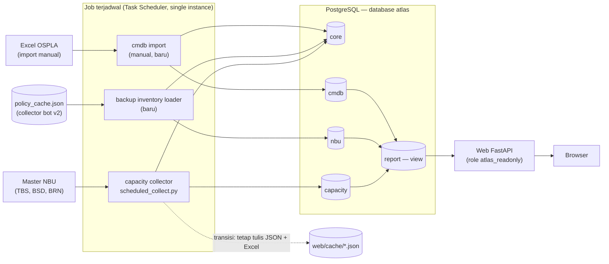

# Fase 2 — Design: Dashboard ATLAS Berbasis Database

| | |
|---|---|
| Versi | 0.1 (draft untuk approval) |
| Tanggal | 2026-11-26 |
| Baseline | Guide §3–§9, §18 Phase 2 |
| Dasar | [01-assessment-report.md](01-assessment-report.md), [02-db-assessment.md](02-db-assessment.md), web V4 di `web/` |
| Status | **Menunggu approval owner — belum ada implementasi** |

---

## 1. Tujuan

Semua menu dashboard membaca data dari database `atlas` (PostgreSQL 18), bukan dari file JSON, dan menambah menu **Backup Inventory** dengan pencarian berdasarkan **hostname** dan **aplikasi**.

**Di luar scope dokumen ini** (design terpisah berikutnya): halaman healthcheck bot Telegram, collector delta via audit log, bot v3.

## 2. Requirement & acceptance criteria

| ID | Requirement | Acceptance criteria |
|---|---|---|
| FR1 | Menu Disk Pool membaca DB | Tampilan & angka sama persis dengan versi JSON untuk data collect yang sama |
| FR2 | Menu Tape Library membaca DB | Sama seperti FR1 |
| FR3 | Riwayat kapasitas tersimpan | Setiap collect menghasilkan 1 baris `collect_run` + snapshot; data lama tidak ditimpa |
| FR4 | Menu baru **Backup Inventory** | Muncul di sidebar, gaya visual sama dengan menu lain |
| FR5 | Cari berdasarkan **hostname** | Satu atau banyak hostname (pisah koma/baris), tidak peka huruf besar/kecil, cocok sebagian (perilaku sama dengan bot: `app1` cocok `app10`); hostname yang tidak ditemukan ditampilkan sebagai "Not Available" |
| FR6 | Cari berdasarkan **aplikasi** | Input nama aplikasi (dengan saran otomatis dari CMDB) → semua host aplikasi itu beserta konfigurasi backup-nya; host aplikasi yang tidak punya backup ikut ditampilkan sebagai "Tidak ada backup" |
| FR7 | Filter tambahan | Master server, policy type |
| FR8 | Export hasil pencarian ke Excel | Kolom sama dengan tabel di layar + baris cut-off di atas |
| FR9 | Info kesegaran data | Setiap menu menampilkan "Data per …" dari `collect_run` terakhir yang sukses, dan peringatan jika collect terakhir gagal |
| NFR1 | Performa | Pencarian < 1 detik untuk ±10 ribu baris backup & ±14 ribu baris CMDB |
| NFR2 | Keamanan | Web memakai role DB read-only; tidak ada secret di kode; query parameterized |
| NFR3 | Rollback | Selama transisi collector tetap menulis JSON & Excel lama, sehingga versi web lama bisa dipakai kembali |

### Perbedaan perilaku vs production yang perlu disetujui

| Perubahan | Alasan |
|---|---|
| Hari jadwal backup memakai mapping benar (1 = Minggu). Hasil berbeda dari `dbbackup` lama dan report Collect All bot | Terbukti dari audit log (assessment Lampiran B) |
| Kolom `schedule_days` terisi (di `dbbackup` lama selalu kosong) | Sama dengan report Search bot |
| Hanya policy aktif & bukan onetime/manual (sama dengan bot & loader lama) | Tidak berubah — dicatat agar eksplisit |

## 3. Arsitektur



- Sumber backup inventory awal = `policy_cache.json` (sama dengan loader lama), supaya tidak ada beban tambahan ke master NBU. Nanti diganti collector delta (design terpisah) tanpa mengubah tabel.
- `dbbackup` lama **tidak disentuh**; konsumen lama (Dify, FastAPI :8443, tim lain) tetap jalan.

## 4. Desain database `atlas`

### 4.1 Schema & ERD

```mermaid
erDiagram
    core_collect_run ||--o{ capacity_disk_pool_snapshot : menghasilkan
    core_collect_run ||--o{ capacity_tape_library_snapshot : menghasilkan
    core_collect_run ||--o{ nbu_backup_inventory : menghasilkan
    core_collect_run ||--o{ cmdb_server_inventory : menghasilkan

    core_collect_run {
        bigint id PK
        text source "capacity | tape | backup_inventory | cmdb"
        text status "running | success | partial | failed"
        timestamptz started_at
        timestamptz finished_at
        int row_count
        text error_message
        jsonb details "error per master, file sumber, dll"
    }
    capacity_disk_pool_snapshot {
        bigint id PK
        bigint run_id FK
        text site
        text master
        text disk_pool_name
        numeric usable_tb
        numeric available_tb
        numeric used_tb
        numeric usage_pct
    }
    capacity_tape_library_snapshot {
        bigint id PK
        bigint run_id FK
        text site
        text type_tape
        int total_qty
        int used_qty
        numeric raw_capacity_tb
        numeric used_capacity_tb
        text "dst: ip, serial, storage_name, ..."
    }
    nbu_backup_inventory {
        bigint id PK
        bigint run_id FK
        text master_server
        text policy_name
        text policy_type
        text client_host
        text client_host_norm "lower(trim)"
        text schedule_name
        text schedule_days
        text start_times
        text retention_period
        text "dst: storage, volume_pool, selections, os, hw, backup_type"
    }
    cmdb_server_inventory {
        bigint id PK
        bigint run_id FK
        text hostname
        text hostname_norm "lower(trim)"
        text ip_oam
        text ip_service
        text app_name
        text pic
        text app_priority
        text environment
        text vm_baremetal
        text site
    }
```

| Schema | Tabel / view | Pola isi |
|---|---|---|
| `core` | `collect_run`, `schema_migrations` | Satu baris per eksekusi job; status & error tercatat |
| `capacity` | `disk_pool_snapshot`, `tape_library_snapshot` | **Riwayat** (append). View `disk_pool_latest`, `tape_library_latest` = snapshot dari run sukses terakhir |
| `nbu` | `backup_inventory` | **Hanya data terbaru**: loader mengganti isi dalam satu transaksi (pembaca tetap melihat data lama sampai commit — tanpa view swap A/B). Riwayat cukup lewat `collect_run` |
| `cmdb` | `server_inventory` | Data terbaru dari import terakhir. **Duplikat hostname dipertahankan** (satu host bisa punya beberapa aplikasi); view menggabungkan per host |
| `report` | `backup_inventory_search`, `cmdb_host`, `app_list` | View untuk web: join backup ↔ CMDB lewat `hostname_norm`, aplikasi digabung `string_agg(DISTINCT …)` agar tidak ada baris ganda |

Retensi riwayat kapasitas: ±35 baris disk pool + 4 baris tape per collect × 144/hari ≈ 5.600 baris/hari (±2 juta/tahun, kecil). Usulan: simpan detail 90 hari, lalu 1 snapshot/hari selamanya (job pembersih, Fase berikut).

### 4.2 Index

| Index | Untuk |
|---|---|
| `pg_trgm` GIN pada `nbu.backup_inventory(client_host_norm)` | Cari hostname cocok sebagian (`ILIKE '%x%'`) cepat |
| `pg_trgm` GIN pada `cmdb.server_inventory(lower(app_name))` | Cari & saran nama aplikasi |
| btree `cmdb.server_inventory(hostname_norm)`, `nbu.backup_inventory(master_server, policy_name)` | Join & filter |
| btree `capacity.*_snapshot(run_id)`, `core.collect_run(source, finished_at desc)` | Ambil snapshot terbaru |

Extension: `pg_trgm` (contrib bawaan installer PostgreSQL Windows).

### 4.3 Role (least privilege, guide §5–6)

| Role | Login | Hak |
|---|---|---|
| `atlas_owner` | tidak | Pemilik semua schema & objek |
| `atlas_migrator` | ya | Anggota `atlas_owner`; hanya dipakai saat migrasi/deploy |
| `atlas_app` | ya | INSERT/UPDATE/DELETE di `core`, `capacity`, `nbu`, `cmdb` — dipakai job collector/loader/import |
| `atlas_readonly` | ya | SELECT di `capacity`, `nbu`, `cmdb`, `report`, `core.collect_run` — dipakai web |

Setiap role login diberi `statement_timeout` & `idle_in_transaction_session_timeout`. Password role disimpan di `.env` masing-masing environment.

### 4.4 Migrasi schema

File SQL bernomor di `db/migrations/` (`V001__init.sql`, `V002__...`), dijalankan oleh `scripts/db/migrate.py` yang mencatat versi + checksum di `core.schema_migrations` dan menolak file yang berubah setelah diterapkan.

> Deviasi dari contoh guide (Alembic): aplikasi tidak memakai ORM, sehingga SQL murni lebih sederhana dibaca & direview tim. Akan dicatat di decision log jika disetujui.

## 5. Kontrak API (web)

| Method & path | Respons | Catatan |
|---|---|---|
| `GET /api/data` | **Bentuk JSON sama persis dengan sekarang** (`disk_pools`, `tape_library`, `last_updated`, `tape_last_updated`) | Sumber diganti ke view `*_latest`; frontend Disk Pool & Tape tidak perlu diubah |
| `GET /api/export` | xlsx kapasitas (3 sheet seperti sekarang) | Dibuat dari DB saat diminta |
| `GET /api/backup-inventory/search?hostnames=&app=&master=&policy_type=&limit=&offset=` | `{items[], total, not_found[], cutoff, last_run_status}` | `hostnames` dipisah koma/baris; minimal salah satu dari `hostnames`/`app` wajib; `limit` maks 1000 |
| `GET /api/backup-inventory/apps?q=` | `[{app_name, host_count}]` (maks 20) | Saran otomatis |
| `GET /api/backup-inventory/export?...` | xlsx hasil pencarian | Parameter sama dengan search |
| `GET /api/health` | `{db: ok, sources: {capacity: {status, finished_at}, ...}}` | Dasar halaman healthcheck nanti |

Validasi input di backend (panjang maks, jumlah hostname maks 500); error dikembalikan dengan pesan Bahasa Indonesia + ID error; tidak ada stack trace ke browser.

## 6. Desain UI menu Backup Inventory

```
┌ Sidebar ┐ ┌──────────────────────────────────────────────────────────────┐
│ 🗄️ Disk │ │ Backup Inventory                       Data per 26 Nov 11:23 │
│ 📼 Tape │ ├──────────────────────────────────────────────────────────────┤
│ 🔎 BI ◀ │ │ [Hostname ▼|Aplikasi]  [ textarea / input + saran ]  [Cari]  │
└─────────┘ │ Master: [Semua▼]  Policy type: [Semua▼]           [⬇ Excel] │
            │ ┌ 4 stat tile: Host ditemukan · Policy · Schedule · Not found┐│
            │ └──────────────────────────────────────────────────────────────┘│
            │ Tabel hasil (freeze header, scroll horizontal):                │
            │ Host | Aplikasi | PIC | Policy | Type | Schedule | Hari | Jam | │
            │ Retensi | Storage | Master | OS                                │
            │ (baris "Not Available" diberi warna merah muda)                │
            └──────────────────────────────────────────────────────────────┘
```

Konsisten dengan menu lain: jQuery tanpa build step, tema warna & `buildTable` yang sama, teks Bahasa Indonesia.

## 7. Konfigurasi & environment

| Variabel (`web/.env`, job `.env`) | Contoh DEV |
|---|---|
| `ATLAS_DB_HOST`, `ATLAS_DB_PORT`, `ATLAS_DB_NAME` | `localhost`, `5432`, `atlas` |
| `ATLAS_DB_USER_WEB` / `ATLAS_DB_PASSWORD_WEB` | `atlas_readonly` / (rahasia) |
| `ATLAS_DB_USER_APP` / `ATLAS_DB_PASSWORD_APP` | `atlas_app` / (rahasia) |
| `ATLAS_ALLOW_LIVE_NBU` | `0` |

Web memakai connection pool kecil (2–5 koneksi) ke `localhost`; tidak perlu aturan `pg_hba` baru dari luar server.

## 8. Strategi test (guide §9)

| Jenis | Isi |
|---|---|
| Unit | Parsing policy → baris inventory (termasuk mapping hari, retensi SLP/non-SLP, filter aktif/onetime/manual); normalisasi hostname; parsing input pencarian |
| Migrasi | `migrate.py` dari DB kosong → semua versi; idempotent; tolak checksum berubah |
| Integrasi (DB `atlas_test`) | Loader & import mengisi tabel + `collect_run`; transaksi gagal → data lama utuh |
| API | Status code, validasi input, `not_found`, limit, export xlsx terbuka benar |
| Regresi | `/api/data` versi DB **identik** dengan versi JSON untuk collect yang sama; hasil Search hostname sama dengan report bot `check_v2` (kecuali perbedaan hari yang disetujui) |
| Performa | Pencarian 50 hostname & 1 aplikasi < 1 detik di DEV |

Tool: `pytest`. Bukti hasil test dilampirkan di PR.

## 9. Rencana implementasi ringkas (detail di Fase 3)

| # | Task | Branch / PR |
|---|---|---|
| 0 | Rapikan pekerjaan DEV yang sudah ada (`web/`, skrip dev, dokumen) | `chore/dev-local-baseline` |
| 1 | Migrasi V001: schema, tabel, index, view, role | `feat/db-foundation` |
| 2 | Import CMDB dari Excel → `cmdb` | `feat/db-foundation` |
| 3 | Loader backup inventory (parser bersama, mapping hari benar) → `nbu` | `feat/backup-inventory` |
| 4 | API + menu Backup Inventory + export | `feat/backup-inventory` |
| 5 | Collector kapasitas menulis DB (tetap tulis JSON) + `/api/data` dari DB | `feat/capacity-db` |
| 6 | `/api/health`, dokumentasi, runbook | `feat/capacity-db` |

## 10. Keputusan yang dibutuhkan dari owner

1. Setuju design ini (schema `core/capacity/nbu/cmdb/report`, 4 role, migrasi SQL murni)?
2. Setuju perbedaan perilaku di §2 (hari jadwal benar, `schedule_days` terisi)?
3. Pencarian hostname tetap **cocok sebagian** seperti bot, atau **persis**?
4. Untuk hasil cari per aplikasi: tampilkan juga host yang **tidak punya backup**? (usulan: ya, ditandai)
5. Retensi riwayat kapasitas: 90 hari detail + 1 snapshot/hari selamanya — setuju?
6. Konfirmasi file Excel CMDB yang dipakai: `OSPLA Managed Server-03022026.xlsx` sheet *Master Inventory*?
